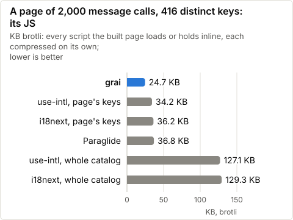
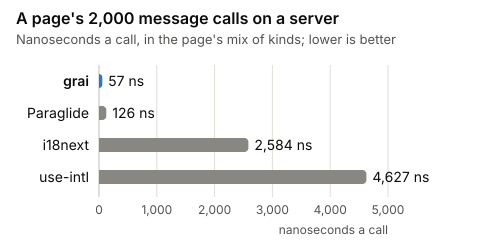
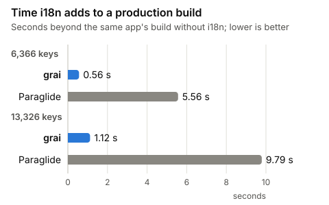
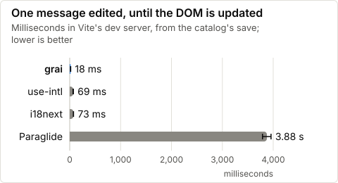
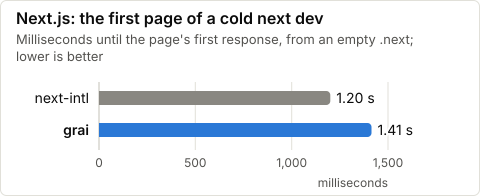
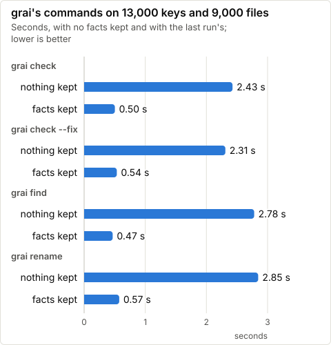

# grai

Translations compiled ahead of time into typed functions, for any JavaScript framework. A page loads only the messages it calls, in its own locale.

*Grai* (Romanian) is a people's way of speaking.

```json
{
  "cart_title": "Your cart",
  "cart_items": "{count :number} items",
  "greeting": "Hello {name}"
}
```

```ts
import { m } from "./src/lib/i18n/messages.js";

m.cart_title();                                // "Your cart"
m.cart_items({ count: 3 });                    // "3 items"
m.greeting({ name: "Ana" }, { locale: "ro" }); // the Romanian message
m.greeting({});                                // type error: `name` is missing
m.cart_items({ count: "3" });                  // type error: `count` is a number
m.cart_titel();                                // type error: no such key
```

## Why grai

- **A page ships only the messages it calls.** The build splits the catalog by key and by locale: a page of 2,000 messages downloads <!-- value:page-grai -->22.6 KB<!-- /value --> of JavaScript, against <!-- value:page-paraglide -->36.7 KB<!-- /value --> on Paraglide and <!-- value:page-i18next -->129.2 KB<!-- /value --> on i18next.
- **A runtime of <!-- value:runtime-grai -->0.6 KB<!-- /value -->,** its whole API, brotli: Paraglide's is <!-- value:runtime-paraglide -->3.6 KB<!-- /value -->, use-intl's <!-- value:runtime-use-intl -->10.2 KB<!-- /value --> and i18next's <!-- value:runtime-i18next -->12.1 KB<!-- /value -->.
- **Typed MessageFormat 2,** the Unicode standard: plurals, selects, number, date and list formatting, and markup. A message is a function typed by its inputs, so a missing or mistyped input is an error where it is called, and a plural takes <!-- value:plural-grai -->42 ns<!-- /value --> on a server, against <!-- value:plural-paraglide -->484 ns<!-- /value --> on Paraglide.
- **Refactoring that reads code as the bundler does.** `grai check`, `check --fix`, `find`, `rename` and `migrate` parse each file and follow its imports, so a key a comment mentions is no read, and `check --fix` never removes a key a page calls. A check of a 13,000-key, 9,000-file project takes <!-- value:check-warm -->0.51 s<!-- /value --> once its facts are kept.
- **Edits in place.** An edited message shows in the open page in <!-- value:dev-grai -->15 ms<!-- /value -->, without a reload; on Paraglide, its plugin compiles again and the edit takes <!-- value:dev-paraglide -->4,576 ms<!-- /value -->.
- **Adapters for six frameworks:** SvelteKit, Next.js, Nuxt, Astro, Vue and React, a Vite plugin for any other app, and a middleware for Workers, Bun, Deno and Node.

## Quick start

```sh
pnpm add -D grai
```

Its commands and plugins need Node 22.18 or later. The output's `server.js` imports `node:async_hooks`, so a project whose type checker reads the output's JavaScript, as a SvelteKit app's reads all of `src`, needs Node's types too: `pnpm add -D @types/node`.

Catalogs are the inlang message format, one JSON file per locale, as Paraglide reads them, and `grai.config.json` names them:

```json
{
  "$schema": "./node_modules/grai/config.schema.json",
  "locales": ["en", "ro"],
  "baseLocale": "en",
  "catalogs": "messages/{locale}.json",
  "outdir": "src/lib/i18n"
}
```

Then add grai to the app:

| Framework | What to add | Docs |
|---|---|---|
| SvelteKit | `grai()` from `grai/sveltekit/vite` before `sveltekit()`, and `handleLocale` in `hooks.server.ts` | [SvelteKit](docs/frameworks.md#sveltekit) |
| Next.js | `withGrai(config)` from `grai/next/config`, the proxy from `grai/next/proxy`, and `bindLocale` in each layout and page | [Next.js](docs/frameworks.md#nextjs) |
| Nuxt | `modules: ["grai/nuxt"]` | [Nuxt](docs/frameworks.md#nuxt) |
| Astro | `integrations: [grai()]` from `grai/astro` | [Astro](docs/frameworks.md#astro) |
| Vue | `grai()` from `grai/vite`, and `Markup` from `grai/vue` | [Vue](docs/frameworks.md#vue) |
| React | `Markup` from `grai/react`, beside Next.js or Vite | [Next.js](docs/frameworks.md#nextjs) |
| Any Vite app | `plugins: [grai()]` from `grai/vite` | [Vite](docs/frameworks.md#vite) |
| Workers, Bun, Deno and Node | `middleware` from the output's `server.js` | [Servers](docs/frameworks.md#workers-bun-deno-and-node) |

`grai compile` writes the output, and `grai watch` writes it again on each edit; each adapter does both for you. The [guide](docs/guide.md) covers the commands, a static site's locale, tests and CI, and [docs/config.md](docs/config.md) every field of the config.

## Performance

Every number here comes from a bench in [`bench/`](bench), run in one window on <!-- value:bench-date -->27 Oct 2026<!-- /value --> on <!-- value:bench-machine -->an Apple M5 Pro with 18 cores<!-- /value -->, beside other work: its one-minute load was <!-- value:bench-load -->10 to 20<!-- /value --> through the window. The catalog is `bench/synthetic.mjs`'s, 6,366 keys in three locales with a production app's shares of plurals, inputs and markup, so anyone can run them. `bench/results/` holds what each run recorded, with its versions and load, and `node scripts/charts.ts` draws these charts from it. [docs/benchmarks.md](docs/benchmarks.md) and [docs/runtime.md](docs/runtime.md) have the method and more rows.

### What a page downloads

<!-- charts:page -->
<picture>
  <source media="(prefers-color-scheme: dark)" srcset="docs/assets/page-js-dark.svg">
  
</picture>

<details>
<summary>The numbers</summary>

|  | JS, KB brotli | JS, KB | hydrates, ms |
| --- | --- | --- | --- |
| grai | 22.6 | 96 | 6.0 |
| Paraglide | 36.7 | 172 | 8.7 |
| i18next | 129.2 | 682 | 12.9 |
| use-intl | 127.1 | 682 | 18.5 |

One Svelte page, server-rendered and hydrated in Chromium, in `ru` (`bench/hydrate.mjs`). grai's row loads its locale's copies of the message chunks, as `grai/sveltekit` serves them.
</details>
<!-- /charts:page -->

### A message call on a server

<!-- charts:server -->
In a page's mix of 2,000 calls, grai takes 42 ns a call against Paraglide's 123 ns. Measured kind by kind in `ro` and `ru`: grai is ahead in each on plain text, messages with inputs and plurals. On markup, the lead changes hands from one locale to the other. Given each call's locale, Paraglide is ahead in each on markup.

<picture>
  <source media="(prefers-color-scheme: dark)" srcset="docs/assets/server-page-dark.svg">
  
</picture>

<details>
<summary>The numbers</summary>

|  | locale | page's mix | text | inputs | plural | markup |
| --- | --- | --- | --- | --- | --- | --- |
| grai | ro | 21 | 15 | 25 | 40 | 99 |
| Paraglide | ro | 103 | 22 | 55 | 598 | 75 |
| i18next | ro | 1,501 | 1,232 | 1,580 | 2,571 | — |
| use-intl | ro | 2,987 | 2,316 | 3,726 | 3,403 | 2,574 |
| grai, given `{ locale }` | ro | 26 | 11 | 18 | 17 | 66 |
| Paraglide, given `{ locale }` | ro | 47 | 11 | 19 | 536 | 52 |
| grai | ru | 42 | 16 | 24 | 42 | 73 |
| Paraglide | ru | 123 | 32 | 44 | 484 | 75 |
| i18next | ru | 2,786 | 1,318 | 1,666 | 2,488 | — |
| use-intl | ru | 4,650 | 3,114 | 2,914 | 4,547 | 2,802 |
| grai, given `{ locale }` | ru | 44 | 10 | 17 | 20 | 89 |
| Paraglide, given `{ locale }` | ru | 50 | 14 | 22 | 465 | 54 |

Nanoseconds a call in Node, inside a request, on the synthetic catalog (`bench/server.mjs`). The page's mix is 1,318 text, 493 inputs, 104 plural and 85 markup calls, each made as an app makes it, a message with markup called for its text; the markup column draws its parts, which i18next has none of. Paraglide 2.29.1, i18next 26.4.7, use-intl 4.14.9.
</details>
<!-- /charts:server -->

### A production build

What i18n adds to an app's production build, against the same app with every message written in.

<!-- charts:build -->
<picture>
  <source media="(prefers-color-scheme: dark)" srcset="docs/assets/build-added-dark.svg">
  
</picture>

<details>
<summary>The numbers</summary>

|  | keys | added | its compile | the rest | hooks Rolldown names |
| --- | --- | --- | --- | --- | --- |
| grai | 6,366 | 0.56 s | 0.14 s | 0.43 s | none of 1 s or more |
| Paraglide | 6,366 | 5.56 s | 5.56 s | 0.00 s | buildStart 5.40 s |
| grai | 13,326 | 1.12 s | 0.19 s | 0.93 s | none of 1 s or more |
| Paraglide | 13,326 | 9.79 s | 9.11 s | 0.68 s | buildStart 9.40 s |

Vite 8.3.5 (Rolldown 1.2.15) builds one app of 64 pages that call every key of the synthetic catalog, on grai, on Paraglide 2.29.1 and with the words written in, each build from a clean checkout in a new process, the three taking turns, medians of 5 (`bench/build-added.mjs`). Added is the build less the build without i18n. Its compile is the library's own, catalogs to output, timed alone, which both plugins run in `buildStart`; the rest is the plugin's other work and Rolldown's on the message modules. Rolldown times the plugins' hooks itself, and names a hook of a second or more; the table gives those of the median build. Paraglide's compile at 6,366 keys took longer alone than all the library adds to the build, as the runs' spread allows, so the table gives it as the whole addition and the rest as none.
</details>
<!-- /charts:build -->

### An edit in development

<!-- charts:dev -->
<picture>
  <source media="(prefers-color-scheme: dark)" srcset="docs/assets/dev-edit-dark.svg">
  
</picture>

<details>
<summary>The numbers</summary>

|  | edit to page, ms |
| --- | --- |
| grai | 14.9 |
| Paraglide | 4,575.8 |
| i18next | 86.6 |
| use-intl | 75.7 |

A catalog saved until Chromium 156.0.8078.4 shows the edit, medians of 20 edits (`bench/hmr.mjs`). grai patches the open page in place; Paraglide's plugin compiles again, and i18next and use-intl send the locale's catalog again.
</details>
<!-- /charts:dev -->

### Next.js in development

<!-- charts:next -->
grai is behind here: in rounds the two apps took in turn, its first page came in a median of 1,873 ms against next-intl's 1,835 ms, the rounds ranging over 1,543–2,113 and 1,261–2,351 ms. Turbopack compiles grai's message functions in each layer that imports them, where next-intl's catalog is data. A built Next.js page is smaller on grai ([docs/runtime.md](docs/runtime.md#nextjs)).

<picture>
  <source media="(prefers-color-scheme: dark)" srcset="docs/assets/next-first-page-dark.svg">
  
</picture>

<details>
<summary>The numbers</summary>

|  | ready, ms | first page, ms | page download, KB brotli |
| --- | --- | --- | --- |
| grai | 258 | 1,873 | 129.0 |
| next-intl | 298 | 1,835 | 230.9 |
| next-intl, client keys picked | — | — | 134.8 |

Next 16.4.3 with Turbopack, next-intl 4.14.9, a page of 400 messages in a server component and 100 in a client one, in `ru`; the apps take turns, medians of 7 (`bench/nextjs.mjs`). The last row picks the client component's keys, as next-intl's docs advise; only its download was measured.
</details>
<!-- /charts:next -->

### The refactoring commands

A cold check parses every file that may read messages and resolves its imports, which is what makes its reads exact, and costs seconds on a large project. Keep the facts it writes in CI's cache ([the guide's CI section](docs/guide.md#ci)), and a check reads only the files that changed.

<!-- charts:check -->
<picture>
  <source media="(prefers-color-scheme: dark)" srcset="docs/assets/check-dark.svg">
  
</picture>

<details>
<summary>The numbers</summary>

|  | nothing kept | facts kept |
| --- | --- | --- |
| check | 2.49 s | 0.51 s |
| check --fix | 2.39 s | 0.49 s |
| find | 2.75 s | 0.38 s |
| rename | 2.59 s | 0.49 s |

Each command in a new Node process, on a synthetic project of 13,000 keys in three locales and 9,000 source files, medians of 3 (`bench/refactor.mjs`). A cold check parses each file whose text may read messages and resolves its imports, which is what makes its reads exact; CI keeps the facts between runs.
</details>
<!-- /charts:check -->

## Compared

| | grai | Paraglide JS | next-intl | i18next |
|---|---|---|---|---|
| Message syntax | MessageFormat 2 | inlang message format | ICU MessageFormat | i18next JSON, ICU through `i18next-icu` |
| Compiled ahead of time | yes | yes | no, read at run time | no, read at run time |
| A page's messages | the ones it calls, in its locale | the ones it calls, in every locale, or in its own with its per-locale build | for client components, the locale's catalog, or the messages the app picks | the namespaces the app loads |
| Typed | each message's inputs | each message's inputs | keys and arguments, with a declaration of the messages | keys, with `CustomTypeOptions` |
| Runtime in a page, brotli | <!-- value:runtime-grai -->0.6 KB<!-- /value --> | <!-- value:runtime-paraglide -->3.6 KB<!-- /value --> | <!-- value:runtime-use-intl -->10.2 KB<!-- /value -->, use-intl's core | <!-- value:runtime-i18next -->12.1 KB<!-- /value --> |
| Frameworks | SvelteKit, Next.js, Nuxt, Astro, Vue, React, servers | any bundler, through its plugins | Next.js | React, Vue, Angular and others, through their packages |

Sources: each project's own documentation ([Paraglide JS](https://inlang.com/m/gerre34r/library-inlang-paraglideJs), [next-intl](https://next-intl.dev/docs/getting-started), [i18next](https://www.i18next.com/overview/getting-started)), and for the sizes, `bench/library-bytes.mjs`.

## Limitations

- **Next.js development reaches its first page no sooner** than next-intl's, as above.
- **A new server process loads the messages more slowly** than i18next or use-intl, though it renders its first page sooner, and with Node's compile cache loads first ([docs/limitations.md](docs/limitations.md)).
- **A cold check costs seconds on a large project,** the price of reading code exactly; CI's cache keeps it to the files that changed.
- **Not supported yet:** `:unit`'s `usage`, and an option's value taken from an input other than a currency, a unit and a time zone. Each is a compile error that names the construct, never an approximation.

[docs/limitations.md](docs/limitations.md) has the rest, each with its reason.

## Coming from Paraglide or i18next

Paraglide's catalogs compile unchanged, and its calls stay the same: `m.key(inputs, { locale })`. [docs/migrating-from-paraglide.md](docs/migrating-from-paraglide.md) gives the steps, the call sites grai refuses, and the few messages whose output differs.

From i18next, next-intl, react-intl or Lingui, `grai import --from i18next|icu <dir>` writes grai catalogs from theirs, and `grai migrate` rewrites each call that names its message plainly and lists every other call for a person: [docs/migrating.md](docs/migrating.md).

## Docs

- [Guide](docs/guide.md): catalogs, commands, a static site's locale, changing locale, tests and CI
- [Frameworks](docs/frameworks.md): Vite, Svelte, SvelteKit, Next.js, Astro, Vue, Nuxt and servers
- [Config](docs/config.md) and [API](docs/api.md)
- [Design](docs/design.md) and [Runtime](docs/runtime.md): the decisions, each with its reason and its numbers

## License

MIT
