# Measured

Every chart here, and the README's, comes from benches anyone can run, on `bench/synthetic.mjs`'s catalog: `pnpm readme` in `bench/` runs them in one window and writes `bench/results/`, and `node scripts/charts.ts` draws the charts, their tables and the README's table at a glance from those files. Each file holds the date, the machine, the load and the libraries' versions it was measured with, and every sample.

How they compare, in every bench:
- **Rounds.** A bench measures each variant it compares once a round, in an order that rotates by one place from round to round, so that each takes every place alike (`bench/rounds.mjs`). In Node, each measurement runs in a process of its own.
- **Medians and intervals.** A figure is the median of its rounds, with the interval of order statistics that holds the median with 95% confidence (`bench/medians.mjs`); with fewer rounds than that needs, the lowest and highest sample, and the confidence they give, which the table names. A chart draws the interval as a whisker across its bar.
- **Pairs.** grai is compared with another variant round by round: their time over grai's in the same round, or for a start, grai's less theirs, so that load the two measurements of a round share cancels out. A comparison whose interval holds 1× (or 0 ms) is level.
- **Setups.** Each other library is measured in the setup its docs advise, and where a second setup is common, in that one too: next-intl with the client component's keys picked and with the whole catalog, i18next and use-intl with a page's own keys and with the whole catalog, and Paraglide's compile with declarations and without.
- **Checks.** Outside each clock, the bench checks what was measured: a compile's texts and declarations, a page's texts, a refactoring command's result.

Each section's numbers, under its charts, say what its clock measures; the sections come strongest first.

## The charts

<!-- charts:all -->
### Compiling after one edit

grai's recompile against Paraglide's Vite plugin in dev (locale modules), each from the compilation it kept.

<picture>
  <source media="(prefers-color-scheme: dark)" srcset="assets/edit-compile-dark.svg">
  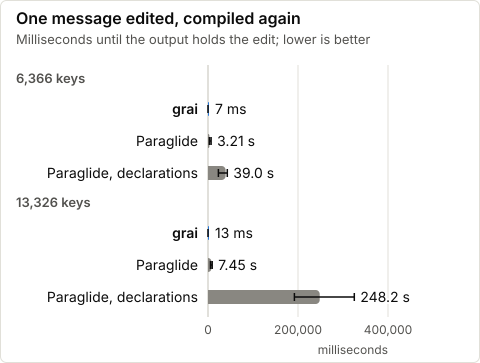
</picture>

The numbers

|  | keys | its first compile | one message edited |
| --- | --- | --- | --- |
| grai | 6,366 | 111 ms (93 ms to 122 ms) | 7 ms (6 ms to 41 ms) |
| Paraglide's Vite plugin in dev, locale modules, without declarations | 6,366 | 3.79 s (3.60 s to 10.2 s) | 3.21 s (3.01 s to 6.97 s) |
| Paraglide's Vite plugin in dev, locale modules, declarations through TypeScript 6 | 6,366 | 50.1 s (26.7 s to 59.7 s) | 39.0 s (23.1 s to 42.8 s) |
| grai | 13,326 | 264 ms (167 ms to 315 ms) | 13 ms (6 ms to 18 ms) |
| Paraglide's Vite plugin in dev, locale modules, without declarations | 13,326 | 7.77 s (6.19 s to 10.4 s) | 7.45 s (5.60 s to 9.44 s) |
| Paraglide's Vite plugin in dev, locale modules, declarations through TypeScript 6 | 13,326 | 280.4 s (148.6 s to 330.4 s) | 248.2 s (192.0 s to 325.0 s) |

The same message edited each time, its text replaced as an editor saves it: grai compiles again by `recompile` from the build its compile before kept, as its Vite plugin and `grai watch` do; Paraglide's Vite plugin, as a dev server drives it, compiles again by its `watchChange` from the compilation it kept, in the layout it takes in development, locale modules, without declarations and with them. Medians of 6 rounds in rotating order, each in a new process (`bench/compile-time.mjs`).

### Choosing an ordinal

<picture>
  <source media="(prefers-color-scheme: dark)" srcset="assets/ordinals-dark.svg">
  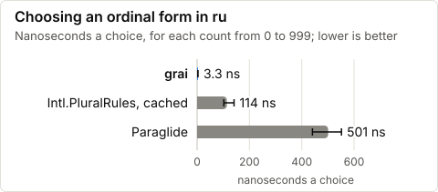
</picture>

The numbers

|  | ro, ns | ro, theirs over grai's | ru, ns | ru, theirs over grai's | en, ns | en, theirs over grai's |
| --- | --- | --- | --- | --- | --- | --- |
| grai | 1.2 ns |  | 3.3 ns |  | 11 ns |  |
| Paraglide | 545 ns | 463× (398× to 551×) | 501 ns | 149× (144× to 163×) | 690 ns | 66× (60× to 76×) |
| Intl.PluralRules, cached | 156 ns | 135× (111× to 155×) | 114 ns | 35× (32× to 45×) | 284 ns | 26× (25× to 30×) |

Each way of choosing an ordinal form is checked against `Intl.PluralRules` on 0 to 10,000 and on fractions, then timed on 0 to 999 in Node, in a process of its own once a round, in an order that rotates (`bench/ordinals.mjs`). grai's rule is the one its compiler writes; Paraglide 2.29.1's is its `registry.plural`; a cached `Intl.PluralRules` is what a library that calls Intl at best does.

### Compiling the catalogs

grai's output always carries each message's declarations, so the like-for-like row is Paraglide's compile with declarations, which it emits through TypeScript 6; its compile without them is beside it.

<picture>
  <source media="(prefers-color-scheme: dark)" srcset="assets/compile-dark.svg">
  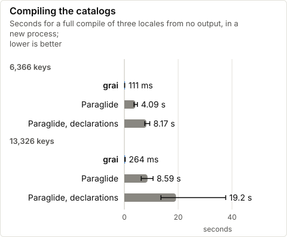
</picture>

The numbers

|  | keys | full compile | nothing changed |
| --- | --- | --- | --- |
| grai | 6,366 | 111 ms (93 ms to 122 ms) | 2 ms (1 ms to 2 ms) |
| Paraglide, message modules, without declarations | 6,366 | 4.09 s (3.59 s to 4.85 s) | the same |
| Paraglide, message modules, declarations through TypeScript 6 | 6,366 | 8.17 s (7.59 s to 9.44 s) | the same |
| grai | 13,326 | 264 ms (167 ms to 315 ms) | 4 ms (2 ms to 4 ms) |
| Paraglide, message modules, without declarations | 13,326 | 8.59 s (6.26 s to 10.7 s) | the same |
| Paraglide, message modules, declarations through TypeScript 6 | 13,326 | 19.2 s (13.6 s to 37.7 s) | the same |

Each compile in a new Node process, timed once the library's modules have loaded, from the same restored catalogs and no output; the variants take turns in rounds whose order rotates, medians of 6 with the interval that holds each (`bench/compile-time.mjs`). Every output's texts and declarations are checked after its clock. Paraglide 2.29.1's compiler is in its production layout, message modules. The ratios in the table at a glance are Paraglide's time over grai's, paired by round.

### Choosing a plural

<picture>
  <source media="(prefers-color-scheme: dark)" srcset="assets/plurals-dark.svg">
  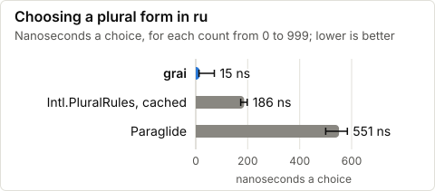
</picture>

The numbers

|  | ro, ns | ro, theirs over grai's | ru, ns | ru, theirs over grai's | en, ns | en, theirs over grai's |
| --- | --- | --- | --- | --- | --- | --- |
| grai | 6.1 ns |  | 15 ns |  | 4.2 ns |  |
| Paraglide | 719 ns | 121× (114× to 387×) | 551 ns | 37× (7.8× to 43×) | 487 ns | 118× (35× to 123×) |
| Intl.PluralRules, cached | 290 ns | 48× (42× to 114×) | 186 ns | 13× (2.6× to 14×) | 142 ns | 32× (10× to 70×) |

Each way of choosing a plural form is checked against `Intl.PluralRules` on 0 to 10,000 and on fractions, then timed on 0 to 999 in Node, in a process of its own once a round, in an order that rotates (`bench/plurals.mjs`). grai's rule is the one its compiler writes; Paraglide 2.29.1's is its `registry.plural`; a cached `Intl.PluralRules` is what a library that calls Intl at best does.

### Completing a key in the editor

In a file of 500 message calls, each library's keys typed its own way: completions as an editor asks TypeScript 6.0.3's language service for them, after `m.` or inside `t("`.

<picture>
  <source media="(prefers-color-scheme: dark)" srcset="assets/types-prefix-dark.svg">
  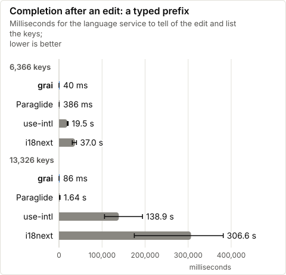
</picture>

<picture>
  <source media="(prefers-color-scheme: dark)" srcset="assets/types-next-dark.svg">
  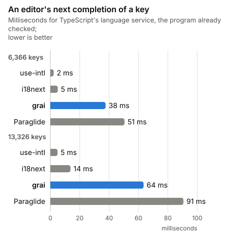
</picture>

The numbers

|  | keys | first completion, the file opened | repeated completion, file unchanged | completion after an edit: a typed prefix | completion after an edit: a new call site | completion after an edit: a key added to the catalog | `tsc --noEmit` |
| --- | --- | --- | --- | --- | --- | --- | --- |
| grai | 6,366 | 352 ms (250 ms to 416 ms) | 38 ms (31 ms to 52 ms) | 53 ms (44 ms to 75 ms) | 55 ms (39 ms to 115 ms) | 49 ms (45 ms to 78 ms) | 111 ms (81 ms to 139 ms) |
| Paraglide | 6,366 | 1.77 s (1.16 s to 3.66 s) | 46 ms (34 ms to 76 ms) | 528 ms (425 ms to 1.72 s) | 577 ms (408 ms to 1.58 s) | 977 ms (755 ms to 2.46 s) | 364 ms (272 ms to 503 ms) |
| i18next | 6,366 | 67.3 s (49.8 s to 72.9 s) | 8 ms (6 ms to 10 ms) | 58.5 s (47.0 s to 69.2 s) | 52.5 s (38.7 s to 67.6 s) | 62.5 s (52.5 s to 74.5 s) | 708 ms (615 ms to 765 ms) |
| use-intl | 6,366 | 25.1 s (20.1 s to 35.1 s) | 3 ms (2 ms to 3 ms) | 31.4 s (23.6 s to 44.4 s) | 30.7 s (21.5 s to 46.1 s) | 31.0 s (21.0 s to 38.4 s) | 638 ms (563 ms to 734 ms) |
| grai | 13,326 | 438 ms (312 ms to 533 ms) | 69 ms (48 ms to 107 ms) | 96 ms (77 ms to 145 ms) | 89 ms (68 ms to 145 ms) | 89 ms (71 ms to 133 ms) | 120 ms (81 ms to 252 ms) |
| Paraglide | 13,326 | 3.30 s (2.36 s to 4.99 s) | 84 ms (59 ms to 130 ms) | 1.46 s (1.08 s to 2.20 s) | 1.34 s (1.09 s to 1.98 s) | 2.29 s (2.02 s to 4.04 s) | 836 ms (557 ms to 1.15 s) |
| i18next | 13,326 | 301.1 s (191.5 s to 339.4 s) | 14 ms (10 ms to 16 ms) | 289.2 s (215.8 s to 349.0 s) | 287.5 s (224.4 s to 333.7 s) | 325.9 s (184.7 s to 328.9 s) | 1.19 s (1.01 s to 1.57 s) |
| use-intl | 13,326 | 151.2 s (82.6 s to 176.6 s) | 5 ms (4 ms to 6 ms) | 143.2 s (91.2 s to 187.6 s) | 162.9 s (130.6 s to 190.3 s) | 188.9 s (137.1 s to 207.6 s) | 1.34 s (963 ms to 1.91 s) |

grai's and Paraglide's generated declarations, i18next's keys merged from the locale's JSON through `CustomTypeOptions`, and use-intl's inferred from the messages it is given, the types next-intl uses too (`bench/types.mjs`). Each sample is a new process, every library taking one a round in an order that rotates, medians of 9; with 9 rounds an interval is the lowest and highest sample, and holds the median with the confidence it names. Every list must hold exactly the keys the library's types give. TypeScript 7.0.2's language server answers the same completions too: its samples are in `bench/results/types-*.json`. `tsc --noEmit` is TypeScript 7.0.2's, its process included.

### A production build

What i18n adds to an app's production build, against the same app with every message's text written in. Each build is clocked from before Vite and the library's plugin are imported until the build has written its files; Node's own start is not in it.

<picture>
  <source media="(prefers-color-scheme: dark)" srcset="assets/build-added-dark.svg">
  
</picture>

The numbers

|  | keys | build | added | its plugins' buildStart | the rest |
| --- | --- | --- | --- | --- | --- |
| without i18n | 6,366 | 0.12 s (0.11 s to 0.14 s) |  |  |  |
| grai | 6,366 | 0.92 s (0.78 s to 1.41 s) | 0.80 s (0.64 s to 1.27 s) | 0.12 s (0.10 s to 0.15 s) | 0.68 s (0.54 s to 1.12 s) |
| Paraglide | 6,366 | 4.64 s (4.13 s to 6.23 s) | 4.52 s (4.03 s to 6.09 s) | 4.11 s (3.73 s to 5.43 s) | 0.41 s (0.29 s to 0.74 s) |
| without i18n | 13,326 | 0.11 s (0.10 s to 0.11 s) |  |  |  |
| grai | 13,326 | 1.21 s (1.18 s to 1.42 s) | 1.10 s (1.08 s to 1.32 s) | 0.18 s (0.17 s to 0.23 s) | 0.93 s (0.90 s to 1.09 s) |
| Paraglide | 13,326 | 7.82 s (7.42 s to 8.48 s) | 7.71 s (7.32 s to 8.38 s) | 7.19 s (6.82 s to 7.90 s) | 0.53 s (0.49 s to 0.59 s) |

Vite 8.3.5 (Rolldown 1.2.15) builds one app of 64 pages that call every key of the synthetic catalog, on grai, on Paraglide 2.29.1 and with every message's text written in, each build a new process from a clean checkout; the three take turns in rounds whose order rotates, medians of 9 with the interval that holds each (`bench/build-added.mjs`). Added is a build less the build without i18n of the same round. Its plugins' `buildStart`, where both compile the catalogs, is timed around the plugins' own hooks; the rest is everything else the library adds. After each build, outside its clock, every page is opened in Chromium and must draw its texts. Rolldown names a plugin hook of a second or more: in the median build, grai's none of 1 s or more, Paraglide's buildStart 7.20 s at 13,326 keys.

### Next.js: an edit in development

<picture>
  <source media="(prefers-color-scheme: dark)" srcset="assets/next-edit-dark.svg">
  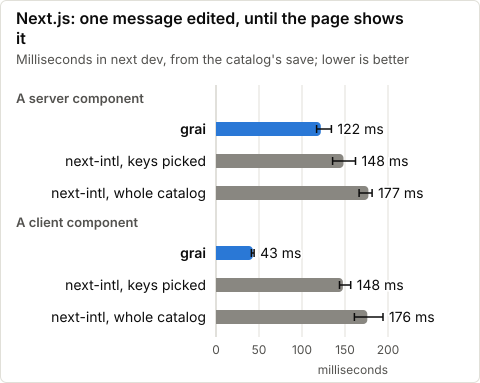
</picture>

The numbers

|  | server component | client component |
| --- | --- | --- |
| grai | 122 ms (117 ms to 134 ms), written in 9.2 ms | 43 ms (41 ms to 44 ms), written in 8.4 ms |
| next-intl, keys picked | 148 ms (136 ms to 162 ms) | 148 ms (144 ms to 157 ms) |
| next-intl, whole catalog | 177 ms (166 ms to 182 ms) | 176 ms (161 ms to 194 ms) |

Next 16.4.3 with Turbopack, next-intl 4.14.9, a page of 400 messages in a server component and 100 in a client one, in `ru`. A catalog saved as an editor saves it until Chromium 156.0.8078.4 shows the edit in the open page, 18 edits an app, in sessions the apps take in rotating rounds, the components' order rotating too, each page checked whole after every edit (`bench/nextjs.mjs`). For grai, "written" is when the file holding the edit was written; the rest is Next's. "keys picked" is next-intl with the client component's keys picked, as its docs advise; "whole catalog" sends the client the locale's whole catalog, its default.

### An edit in development

<picture>
  <source media="(prefers-color-scheme: dark)" srcset="assets/dev-edit-dark.svg">
  
</picture>

The numbers

|  | edit to the DOM updated | theirs over grai's, by round |
| --- | --- | --- |
| grai | 17 ms (16 ms to 20 ms) |  |
| Paraglide | 4.13 s (4.01 s to 4.25 s) | 224.50× (201.80× to 300.20×) |
| i18next | 82 ms (77 ms to 86 ms) | 4.96× (3.13× to 6.33×) |
| use-intl | 72 ms (66 ms to 77 ms) | 3.86× (3.14× to 5.00×) |

A catalog saved as an editor saves it until the page's MutationObserver in Chromium 156.0.8078.4 sees the edited text, 45 edits a design (`bench/hmr.mjs`). Each design's session takes its turn once a round, in an order that rotates, 9 rounds, each design's edits paired with grai's plugin's of the same round. grai patches the open page in place; Paraglide's plugin compiles again, and i18next and use-intl send the locale's catalog again.

### A message call on a server

Kind by kind against Paraglide, in `ro` and `ru`, each ratio's interval taken from rounds: as an app calls them, grai is ahead on plurals; level on plain text and markup; ahead in one locale and not the other on messages with inputs. With each call given its locale, grai is ahead on plurals; level on markup; ahead in one locale and not the other on plain text and messages with inputs.

<picture>
  <source media="(prefers-color-scheme: dark)" srcset="assets/server-page-dark.svg">
  
</picture>

The numbers

|  | locale | page's mix, ns | text, theirs over grai's | inputs, theirs over grai's | plural, theirs over grai's | markup, theirs over grai's |
| --- | --- | --- | --- | --- | --- | --- |
| grai | ro | 20 |  |  |  |  |
| Paraglide | ro | 64 | 1.05× (0.49× to 2.6×) | 1.97× (0.72× to 4.1×) | 20× (15× to 31×) | 1.08× (0.42× to 1.30×) |
| i18next | ro | 1,852 | 77× (53× to 150×) | 61× (29× to 115×) | 97× (80× to 120×) | — |
| use-intl | ro | 3,856 | 125× (108× to 202×) | 99× (55× to 190×) | 125× (82× to 149×) | 37× (20× to 49×) |
| Paraglide, given `{ locale }` | ro | 46 | 0.73× (0.33× to 0.95×) | 0.73× (0.42× to 0.92×) | 24× (18× to 47×) | 0.88× (0.41× to 1.19×) |
| grai, given `{ locale }` | ro | 13 |  |  |  |  |
| grai | ru | 17 |  |  |  |  |
| Paraglide | ru | 55 | 1.16× (0.78× to 1.62×) | 2.3× (1.11× to 3.4×) | 19× (11× to 25×) | 1.10× (0.93× to 1.30×) |
| i18next | ru | 2,331 | 89× (49× to 130×) | 88× (37× to 125×) | 93× (57× to 138×) | — |
| use-intl | ru | 3,492 | 161× (78× to 209×) | 131× (67× to 465×) | 126× (83× to 173×) | 36× (21× to 147×) |
| Paraglide, given `{ locale }` | ru | 48 | 0.70× (0.38× to 1.34×) | 0.61× (0.29× to 1.29×) | 22× (15× to 29×) | 1.08× (0.75× to 1.28×) |
| grai, given `{ locale }` | ru | 26 |  |  |  |  |

Each variant makes the same 2,000 calls inside a request in Node, built as an app's server build has them with its library's own plugins, its text checked against Paraglide's (`bench/server.mjs`). The clock is a warm batch inside one request: each run of the calls, divided by their number, after a warm-up. The page's mix is 1,318 text, 493 inputs, 104 plural and 85 markup calls. Each variant runs in a process of its own once a round, in an order that rotates; a ratio is the variant's calls over grai's of the same shape in the same round, given `{ locale }` against grai given it too. i18next draws no markup parts. Paraglide 2.29.1, i18next 26.4.7, use-intl 4.14.9.

### Next.js: a cold dev server's first page

Turbopack compiles grai's message functions in each layer that imports them, where next-intl's catalog is data. A built Next.js page is smaller on grai (in the numbers below).

<picture>
  <source media="(prefers-color-scheme: dark)" srcset="assets/next-first-page-dark.svg">
  
</picture>

The numbers

|  | first page | grai's less theirs, by round | built page download, brotli |
| --- | --- | --- | --- |
| grai | 1.96 s (1.64 s to 2.44 s) |  | 129.1 KB |
| next-intl, keys picked | 1.97 s (1.85 s to 2.29 s) | −98 ms (−308 ms to +157 ms) | 134.7 KB |
| next-intl, whole catalog | 1.83 s (1.68 s to 2.12 s) | +135 ms (−186 ms to +419 ms) | 230.8 KB |
| grai, fresh clone | 2.06 s (1.95 s to 2.24 s) |  | — |

Next 16.4.3 with Turbopack, next-intl 4.14.9, a page of 400 messages in a server component and 100 in a client one, in `ru`. `next dev` from an empty .next, from its launch until the page's first response is complete, the apps taking turns in rounds whose order rotates, 12 rounds, each pair's difference taken in the same round (`bench/nextjs.mjs`). grai's app starts with the groups of keys its watch saved; the fresh clone's starts with no output at all. "keys picked" is next-intl with the client component's keys picked, as its docs advise; "whole catalog" sends the client the locale's whole catalog, its default. The download is each app's page after `next build`, every response compressed with brotli.

### Hydrating a page

<picture>
  <source media="(prefers-color-scheme: dark)" srcset="assets/hydrate-dark.svg">
  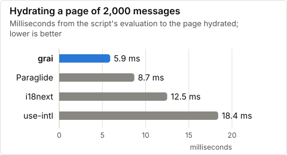
</picture>

The numbers

|  | hydrates, ms | theirs over grai's |
| --- | --- | --- |
| grai | 5.9 ms |  |
| Paraglide | 9.8 ms | 1.69× (1.59× to 1.80×) |
| i18next, page's keys | 14.3 ms | 2.4× (2.2× to 2.6×) |
| use-intl, page's keys | 21.0 ms | 3.6× (3.3× to 3.7×) |
| i18next, whole catalog | 14.1 ms | 2.4× (2.3× to 2.6×) |
| use-intl, whole catalog | 20.2 ms | 3.5× (3.3× to 3.7×) |

The page of the chart above, in Chromium 156.0.8078.4, no CPU slowdown, in `ru` (`bench/hydrate.mjs`): `hydrate` timed from when every module has been evaluated until it returns, Svelte's recovery off. Each variant loads in a browser of its own once a round, in an order that rotates, 16 rounds; ratios are each variant's over grai's in the same round. Its rows at a fourfold CPU slowdown are in `bench/results/hydrate-synthetic.json`.

### What a page downloads

<picture>
  <source media="(prefers-color-scheme: dark)" srcset="assets/page-js-dark.svg">
  
</picture>

The numbers

|  | JS, KB brotli | JS, KB |
| --- | --- | --- |
| grai | 24.7 | 101 |
| Paraglide | 36.8 | 170 |
| i18next, page's keys | 36.2 | 155 |
| use-intl, page's keys | 34.2 | 150 |
| i18next, whole catalog | 129.3 | 681 |
| use-intl, whole catalog | 127.1 | 681 |

One Svelte page built with Vite, each library's build with its own plugins, served as the build wrote it with the server's render drawn in, loaded in Chromium in `ru` (`bench/hydrate.mjs`). Its JS is every script it loads, each compressed on its own with brotli, and those its index.html holds inline. grai's page loads its locale's copies of the message chunks, as `@xyrolle/grai/sveltekit` serves them; i18next and use-intl load the page's own keys, as both advise, or the locale's whole catalog.

### The runtime

<picture>
  <source media="(prefers-color-scheme: dark)" srcset="assets/runtime-dark.svg">
  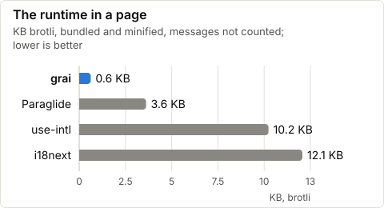
</picture>

The numbers

|  | KB brotli | KB |
| --- | --- | --- |
| grai, as its build writes the locale's copies | 1.4 | 3.3 |
| Paraglide, every locale | 1.8 | 4.7 |
| i18next | 12.2 | 42.8 |
| use-intl | 10.2 | 38.2 |
| grai, runtime.js with every export, alone | 0.6 | 1.4 |
| Paraglide, runtime.js with every export, alone | 3.6 | 10.4 |
| i18next, init and t, alone | 12.1 | 42.5 |
| use-intl, createTranslator, alone | 10.2 | 38.1 |

The runtime is what a library adds to a page that shows three messages, a plain text, a text with an input and a plural: the page's JS, built as an app's client build makes it with the library's own plugins and loaded in Chromium, less the same page's with the three texts written in (`bench/library-bytes.mjs`, in `ru`). Below it, the modules this figure once stood for, each bundled alone by Rolldown for the browser: grai's and Paraglide's runtime modules with every export, i18next set up with `init` and `t`, and use-intl's `createTranslator`.

### A server render

<picture>
  <source media="(prefers-color-scheme: dark)" srcset="assets/ssr-dark.svg">
  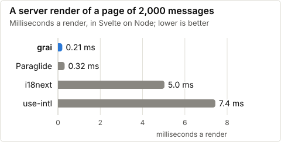
</picture>

The numbers

|  | ro, ms | ro, theirs over grai's | ru, ms | ru, theirs over grai's |
| --- | --- | --- | --- | --- |
| grai | 0.15 ms |  | 0.14 ms |  |
| Paraglide | 0.19 ms | 1.19× (0.97× to 1.70×) | 0.17 ms | 1.25× (1.04× to 1.64×) |
| i18next | 4.5 ms | 30× (27× to 41×) | 4.2 ms | 31× (24× to 42×) |
| use-intl | 6.3 ms | 44× (33× to 49×) | 6.1 ms | 43× (36× to 51×) |
| the words written into the page | 0.04 ms | 0.29× (0.22× to 0.33×) | 0.04 ms | 0.28× (0.23× to 0.35×) |

Svelte renders one page of 2,000 message calls inside a request already open, as an app built with Vite renders it, its messages from each library built with its own plugins (`bench/ssr.mjs`). The clock is a warm render, `render(Page, { props })` after a warm-up; compiling, imports, the libraries' setup and the middleware are outside it. Each variant renders in a process of its own once a round, in an order that rotates; medians of the rounds with the interval that holds each, and each variant's ratio to grai's in the same round. The last row writes each message without a selector into the template. Paraglide 2.29.1, i18next 26.4.7, use-intl 4.14.9.

### Starting the dev server

<picture>
  <source media="(prefers-color-scheme: dark)" srcset="assets/dev-start-dark.svg">
  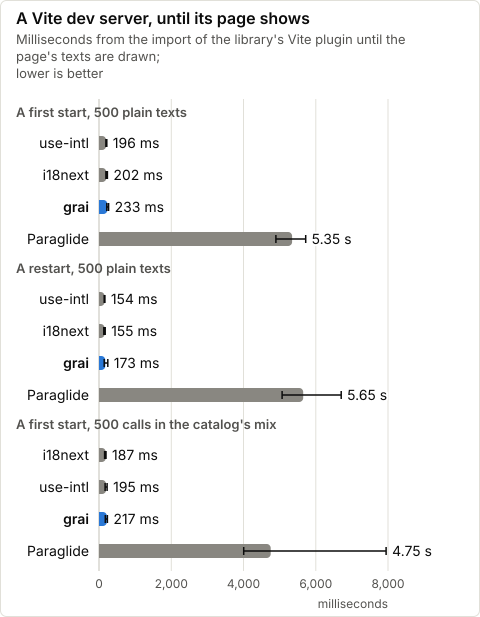
</picture>

The numbers

|  | start | until shown | grai's less theirs, by round |
| --- | --- | --- | --- |
| grai | A first start, 500 plain texts | 179 ms (163 ms to 204 ms) |  |
| Paraglide | A first start, 500 plain texts | 4.52 s (4.21 s to 5.93 s) | −4,351 ms (−5,747 ms to −4,045 ms) |
| i18next | A first start, 500 plain texts | 161 ms (149 ms to 298 ms) | +27 ms (−71 ms to +43 ms) |
| use-intl | A first start, 500 plain texts | 187 ms (167 ms to 287 ms) | −6 ms (−19 ms to +24 ms) |
| no messages | A first start, 500 plain texts | 77 ms (67 ms to 120 ms) | +101 ms (+78 ms to +127 ms) |
| grai | A restart, 500 plain texts | 162 ms (131 ms to 215 ms) |  |
| Paraglide | A restart, 500 plain texts | 5.20 s (4.74 s to 5.46 s) | −5,052 ms (−5,328 ms to −4,613 ms) |
| i18next | A restart, 500 plain texts | 156 ms (134 ms to 223 ms) | +4 ms (−44 ms to +50 ms) |
| use-intl | A restart, 500 plain texts | 153 ms (134 ms to 184 ms) | +5 ms (−52 ms to +35 ms) |
| no messages | A restart, 500 plain texts | 92 ms (81 ms to 115 ms) | +61 ms (+50 ms to +134 ms) |
| grai | A first start, 500 calls in the catalog's mix | 201 ms (177 ms to 311 ms) |  |
| Paraglide | A first start, 500 calls in the catalog's mix | 4.59 s (4.29 s to 6.19 s) | −4,407 ms (−5,876 ms to −4,092 ms) |
| i18next | A first start, 500 calls in the catalog's mix | 167 ms (148 ms to 189 ms) | +41 ms (+2 ms to +83 ms) |
| use-intl | A first start, 500 calls in the catalog's mix | 183 ms (158 ms to 203 ms) | +18 ms (−15 ms to +36 ms) |
| no messages | A first start, 500 calls in the catalog's mix | 83 ms (74 ms to 107 ms) | +122 ms (+102 ms to +187 ms) |

Each start is a new Node process, timed from the import of its library's Vite plugin, as an app's config imports it before its server starts, once Vite and Chromium have loaded, until the frame drawn after the page's texts are in the DOM (`bench/dev-start.mjs`). A first start is in a new directory with no output and no cache, Vite's own among them; a restart follows a first start of its own library and keeps what it wrote. i18next and use-intl have no plugin to import and load the locale's catalog in the page. Every library starts once a round, in an order that rotates; medians with the interval that holds each, and grai's start less each other's of the same round. The page with no messages draws the same texts from its own code.

### The refactoring commands

A cold check parses every file that may read messages and resolves its imports, which is what makes its reads exact, and costs seconds on a large project. Keep the facts it writes in CI's cache ([the guide's CI section](guide.md#ci)), and a check reads only the files that changed.

<picture>
  <source media="(prefers-color-scheme: dark)" srcset="assets/check-dark.svg">
  
</picture>

The numbers

|  | no facts or file listing kept | what the run before left |
| --- | --- | --- |
| `grai check --json` | 2.50 s (2.24 s to 2.68 s) | 0.48 s (0.43 s to 0.72 s) |
| `grai find area70_label_5793` | 2.48 s (2.41 s to 2.58 s) | 0.38 s (0.37 s to 0.46 s) |
| `grai rename area70_label_5793 area70_label_5793_x` | 2.55 s (2.47 s to 2.60 s) | 0.44 s (0.43 s to 0.47 s) |
| `grai check --fix` | 2.69 s (2.62 s to 2.75 s) | 0.58 s (0.54 s to 0.62 s) |

Grai's CLI in a new Node process, from its launch until it exits, on a synthetic project of 13,000 keys in three locales and 9,000 source files; cold and warm interleaved in rounds whose order rotates, medians of 6 with the interval that holds each (`bench/refactor.mjs`). Cold keeps nothing grai keeps between commands; the compiled output and the file system's caches stay. Each result is checked exactly after its clock.

<!-- /charts:all -->

## Two production apps

The benches that take an app run on two production apps' catalogs too, app A's (6,379 keys) and app B's (13,326 keys), where `GRAI_BENCH_A` and `GRAI_BENCH_B` name their checkouts. The apps are private, so their results are not published here; the synthetic catalog has app A's shares of plurals, inputs and markup, and the 13,326-key charts app B's size.
