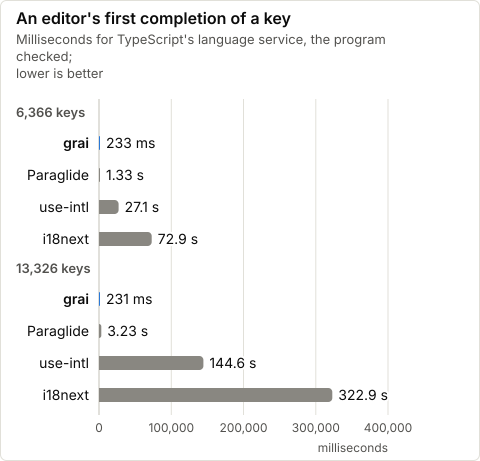

# Measured

Every chart here, and the README's, comes from benches anyone can run, on `bench/synthetic.mjs`'s catalog: `pnpm readme` in `bench/` runs them in one window and writes `bench/results/`, and `node scripts/charts.ts` draws the charts, their tables and the README's table at a glance from those files. Each file holds the date, the machine, the load and the libraries' versions it was measured with. Each section's numbers, under its charts, say what was measured and how; the sections come strongest first.

## The charts

<!-- charts:all -->
### Compiling after one edit

<picture>
  <source media="(prefers-color-scheme: dark)" srcset="assets/edit-compile-dark.svg">
  
</picture>

The numbers

|  | keys | one message edited |
| --- | --- | --- |
| grai | 6,366 | 11 ms |
| Paraglide | 6,366 | 4.45 s |
| grai | 13,326 | 12 ms |
| Paraglide | 13,326 | 6.32 s |

grai compiles again only what the edit changed, from the build it kept; Paraglide compiles everything again, without declarations, as its Vite plugin does on an edit (`bench/compile-time.mjs`).

### Compiling the catalogs

grai's output is typed: it writes each message's declarations as it compiles. Paraglide writes its own only when asked, through TypeScript's compiler, so it is measured both ways.

<picture>
  <source media="(prefers-color-scheme: dark)" srcset="assets/compile-dark.svg">
  
</picture>

The numbers

|  | keys | full compile | nothing changed | one message edited |
| --- | --- | --- | --- | --- |
| grai | 6,366 | 124 ms | 2 ms | 11 ms |
| Paraglide, message modules, without declarations | 6,366 | 4.45 s | the same | the same |
| Paraglide, message modules, with declarations | 6,366 | 9.49 s | the same | the same |
| Paraglide, locale modules, with declarations | 6,366 | 55.6 s | the same | the same |
| grai | 13,326 | 147 ms | 2 ms | 12 ms |
| Paraglide, message modules, without declarations | 13,326 | 6.32 s | the same | the same |
| Paraglide, message modules, with declarations | 13,326 | 13.2 s | the same | the same |
| Paraglide, locale modules, with declarations | 13,326 | 225.5 s | the same | the same |

Each compile in a new Node process, timed once its modules have loaded, from no output (`bench/compile-time.mjs`). grai's times are medians of 3, and so are Paraglide 2.29.1's in its message-module layout, without declarations and with them, which go through TypeScript 6. Its locale-module layout with declarations, minutes a compile, is one run each. Paraglide compiles everything again on any change.

### Choosing an ordinal

<picture>
  <source media="(prefers-color-scheme: dark)" srcset="assets/ordinals-dark.svg">
  
</picture>

The numbers

|  | ro, ns | ru, ns | en, ns |
| --- | --- | --- | --- |
| grai | 3.8 ns | 4.4 ns | 12 ns |
| Paraglide | 599 ns | 493 ns | 682 ns |
| Intl.PluralRules, cached | 195 ns | 141 ns | 310 ns |

Each way of choosing an ordinal form is checked against `Intl.PluralRules` on 0 to 10,000 and on fractions, then timed on 0 to 999 in Node (`bench/ordinals.mjs`). grai's rule is the one its compiler writes; Paraglide 2.29.1's is its `registry.plural`.

### Completing a key in the editor

In a file of 500 message calls, an editor's first completion of a key checks the whole program; the ones after it complete from what it checked.

<picture>
  <source media="(prefers-color-scheme: dark)" srcset="assets/types-first-dark.svg">
  
</picture>

<picture>
  <source media="(prefers-color-scheme: dark)" srcset="assets/types-next-dark.svg">
  
</picture>

The numbers

|  | keys | first completion, ms | next completion, ms | `tsc --noEmit`, ms |
| --- | --- | --- | --- | --- |
| grai | 6,366 | 233 | 38 | 102 |
| Paraglide | 6,366 | 1,334 | 51 | 292 |
| i18next | 6,366 | 72,932 | 5 | 721 |
| use-intl | 6,366 | 27,087 | 2 | 682 |
| grai | 13,326 | 231 | 64 | 97 |
| Paraglide | 13,326 | 3,226 | 91 | 709 |
| i18next | 13,326 | 322,895 | 14 | 1,259 |
| use-intl | 13,326 | 144,556 | 5 | 1,500 |

Each library's keys typed its own way: grai's and Paraglide's generated declarations, i18next's keys merged from the locale's JSON through `CustomTypeOptions`, and use-intl's inferred from the messages it is given, the types next-intl uses too (`bench/types.mjs`). The completions are TypeScript 6.0.3's language service's, after `m.` or inside `t("`, as an editor asks for them, medians of 3 new services. `tsc --noEmit` is TypeScript 7.0.2's, its process included, a median of 3.

### Choosing a plural

<picture>
  <source media="(prefers-color-scheme: dark)" srcset="assets/plurals-dark.svg">
  
</picture>

The numbers

|  | ro, ns | ru, ns | en, ns |
| --- | --- | --- | --- |
| grai | 9.7 ns | 15 ns | 4.4 ns |
| Paraglide | 736 ns | 537 ns | 525 ns |
| Intl.PluralRules, cached | 329 ns | 206 ns | 129 ns |

Each way of choosing a plural form is checked against `Intl.PluralRules` on 0 to 10,000 and on fractions, then timed on 0 to 999 in Node (`bench/plurals.mjs`). grai's rule is the one its compiler writes; Paraglide 2.29.1's is its `registry.plural`.

### A production build

What i18n adds to an app's production build, against the same app with every message written in.

<picture>
  <source media="(prefers-color-scheme: dark)" srcset="assets/build-added-dark.svg">
  
</picture>

The numbers

|  | keys | added | its compile | the rest | hooks Rolldown names |
| --- | --- | --- | --- | --- | --- |
| grai | 6,366 | 0.45 s | 0.11 s | 0.34 s | none of 1 s or more |
| Paraglide | 6,366 | 4.22 s | 4.05 s | 0.16 s | buildStart 4.00 s |
| grai | 13,326 | 0.92 s | 0.20 s | 0.73 s | none of 1 s or more |
| Paraglide | 13,326 | 8.40 s | 7.95 s | 0.46 s | buildStart 8.00 s |

Vite 8.3.5 (Rolldown 1.2.15) builds one app of 64 pages that call every key of the synthetic catalog, on grai, on Paraglide 2.29.1 and with the words written in, each build from a clean checkout in a new process, the three taking turns, medians of 5 (`bench/build-added.mjs`). Added is the build less the build without i18n. Its compile is the library's own, catalogs to output, timed alone, which both plugins run in `buildStart`; the rest is the plugin's other work and Rolldown's on the message modules. Rolldown times the plugins' hooks itself, and names a hook of a second or more; the table gives those of the median build.

### The runtime

<picture>
  <source media="(prefers-color-scheme: dark)" srcset="assets/runtime-dark.svg">
  
</picture>

The numbers

|  | KB brotli | KB |
| --- | --- | --- |
| grai | 0.6 | 1.4 |
| Paraglide | 3.6 | 10.5 |
| i18next | 12.1 | 42.5 |
| use-intl | 10.2 | 38.1 |

Bundled and minified by Rolldown, messages not counted (`bench/library-bytes.mjs`, in `ru`): grai's and Paraglide's runtime modules with every export, i18next as a page sets it up (`i18next.init` and `t`), and use-intl's `createTranslator`.

### An edit in development

<picture>
  <source media="(prefers-color-scheme: dark)" srcset="assets/dev-edit-dark.svg">
  
</picture>

The numbers

|  | edit to page, ms |
| --- | --- |
| grai | 15.2 |
| Paraglide | 3,073.5 |
| i18next | 74.3 |
| use-intl | 71.7 |

A catalog saved until Chromium 156.0.8078.4 shows the edit, medians of 20 edits (`bench/hmr.mjs`). grai patches the open page in place; Paraglide's plugin compiles again, and i18next and use-intl send the locale's catalog again.

### A message call on a server

In a page's mix of 2,000 calls, grai takes 57 ns a call against Paraglide's 126 ns. Measured kind by kind in `ro` and `ru`: grai is ahead in each on plain text, messages with inputs and plurals. On markup, the lead changes hands from one locale to the other. Given each call's locale, Paraglide is ahead in each on plain text and markup.

<picture>
  <source media="(prefers-color-scheme: dark)" srcset="assets/server-page-dark.svg">
  
</picture>

The numbers

|  | locale | page's mix | text | inputs | plural | markup |
| --- | --- | --- | --- | --- | --- | --- |
| grai | ro | 66 | 34 | 42 | 61 | 160 |
| Paraglide | ro | 373 | 116 | 96 | 1,075 | 114 |
| i18next | ro | 2,612 | 2,026 | 2,778 | 4,570 | — |
| use-intl | ro | 4,978 | 4,583 | 4,809 | 6,507 | 3,911 |
| grai, given `{ locale }` | ro | 36 | 26 | 40 | 44 | 159 |
| Paraglide, given `{ locale }` | ro | 179 | 22 | 35 | 1,061 | 98 |
| grai | ru | 57 | 38 | 78 | 64 | 137 |
| Paraglide | ru | 126 | 151 | 283 | 885 | 156 |
| i18next | ru | 2,584 | 2,162 | 3,000 | 4,617 | — |
| use-intl | ru | 4,627 | 3,892 | 4,903 | 6,835 | 4,100 |
| grai, given `{ locale }` | ru | 33 | 29 | 91 | 51 | 136 |
| Paraglide, given `{ locale }` | ru | 152 | 20 | 96 | 794 | 126 |

Nanoseconds a call in Node, inside a request, on the synthetic catalog (`bench/server.mjs`). The page's mix is 1,318 text, 493 inputs, 104 plural and 85 markup calls, each made as an app makes it, a message with markup called for its text; the markup column draws its parts, which i18next has none of. Paraglide 2.29.1, i18next 26.4.7, use-intl 4.14.9.

### Next.js: an edit in development

<picture>
  <source media="(prefers-color-scheme: dark)" srcset="assets/next-edit-dark.svg">
  
</picture>

The numbers

|  | server component, ms | client component, ms |
| --- | --- | --- |
| grai | 142 (written in 5.2) | 73 (written in 4.7) |
| next-intl | 146 | 150 |

Next 16.4.3 with Turbopack, next-intl 4.14.9, a page of 400 messages in a server component and 100 in a client one, in `ru`. A catalog saved until Chromium 156.0.8078.4 shows the edit in the open page, medians of 7 edits (`bench/nextjs.mjs`). In grai's row, the time it took grai to write the edit is in brackets; the rest is Next's.

### What a page downloads

<picture>
  <source media="(prefers-color-scheme: dark)" srcset="assets/page-js-dark.svg">
  
</picture>

The numbers

|  | JS, KB brotli | JS, KB |
| --- | --- | --- |
| grai | 22.6 | 96 |
| Paraglide | 36.7 | 172 |
| i18next | 129.2 | 682 |
| use-intl | 127.1 | 682 |

One Svelte page, server-rendered and hydrated in Chromium, in `ru` (`bench/hydrate.mjs`). grai's row loads its locale's copies of the message chunks, as `grai/sveltekit` serves them.

### A server render

<picture>
  <source media="(prefers-color-scheme: dark)" srcset="assets/ssr-dark.svg">
  
</picture>

The numbers

|  | ro, ms | ru, ms |
| --- | --- | --- |
| grai | 0.19 ms | 0.21 ms |
| Paraglide | 0.28 ms | 0.32 ms |
| i18next | 4.7 ms | 5.0 ms |
| use-intl | 7.3 ms | 7.4 ms |
| the words written into the page | 0.05 ms | 0.06 ms |

Svelte renders one page of 2,000 message calls inside a request, its messages from each library (`bench/ssr.mjs`); the last row has the words written into the page, the floor of a render with no message calls. Paraglide 2.29.1, i18next 26.4.7, use-intl 4.14.9.

### Hydrating a page

<picture>
  <source media="(prefers-color-scheme: dark)" srcset="assets/hydrate-dark.svg">
  
</picture>

The numbers

|  | hydrates, ms |
| --- | --- |
| grai | 5.9 |
| Paraglide | 8.7 |
| i18next | 12.5 |
| use-intl | 18.4 |

The page of the chart above, in Chromium 156.0.8078.4, no CPU slowdown, in `ru`; medians of 15 loads (`bench/hydrate.mjs`). Its rows at a fourfold CPU slowdown are in `bench/results/hydrate-synthetic.json`.

### Next.js: a cold dev server's first page

grai is behind here: in rounds the two apps took in turn, its first page came in a median of 1,415 ms against next-intl's 1,200 ms, the rounds ranging over 1,339–1,450 and 1,129–1,237 ms. Turbopack compiles grai's message functions in each layer that imports them, where next-intl's catalog is data. A built Next.js page is smaller on grai ([docs/runtime.md](runtime.md#nextjs)).

<picture>
  <source media="(prefers-color-scheme: dark)" srcset="assets/next-first-page-dark.svg">
  
</picture>

The numbers

|  | ready, ms | first page, ms | page download, KB brotli |
| --- | --- | --- | --- |
| grai | 218 | 1,415 | 129.0 |
| next-intl | 221 | 1,200 | 230.9 |
| next-intl, client keys picked | — | — | 134.8 |

Next 16.4.3 with Turbopack, next-intl 4.14.9, a page of 400 messages in a server component and 100 in a client one, in `ru`; the apps take turns, medians of 7 (`bench/nextjs.mjs`). The last row picks the client component's keys, as next-intl's docs advise; only its download was measured.

### Starting the dev server

<picture>
  <source media="(prefers-color-scheme: dark)" srcset="assets/dev-start-dark.svg">
  
</picture>

The numbers

|  | start to page, ms | range, ms |
| --- | --- | --- |
| grai | 297 | 231–428 |
| Paraglide | 5,139 | 3,883–12,454 |
| i18next | 201 | 171–232 |
| use-intl | 205 | 192–214 |
| no messages | 93 | 83–202 |

Each start is a new Node process, its dev server made in a new directory with no output and no cache, timed from the server's creation, once Vite, the plugins and Chromium 156.0.8078.4 have loaded, until its page of 500 messages shows (`bench/dev-start.mjs`). grai's plugin and Paraglide's compile the catalogs as the server starts; i18next and use-intl load the locale's catalog in the page. The libraries take turns in an order that rotates each round, the page with no messages among them, its last row; medians of 7.

### The refactoring commands

A cold check parses every file that may read messages and resolves its imports, which is what makes its reads exact, and costs seconds on a large project. Keep the facts it writes in CI's cache ([the guide's CI section](guide.md#ci)), and a check reads only the files that changed.

<picture>
  <source media="(prefers-color-scheme: dark)" srcset="assets/check-dark.svg">
  
</picture>

The numbers

|  | nothing kept | facts kept |
| --- | --- | --- |
| check | 2.43 s | 0.50 s |
| check --fix | 2.31 s | 0.54 s |
| find | 2.78 s | 0.47 s |
| rename | 2.85 s | 0.57 s |

Each command in a new Node process, on a synthetic project of 13,000 keys in three locales and 9,000 source files, medians of 3 (`bench/refactor.mjs`). CI keeps the facts between runs.

<!-- /charts:all -->

## Two production apps

The numbers below come from the catalogs of two real apps, compared with Paraglide 2.29.1:
- app A (SvelteKit, 6,379 keys × 3);
- app B (13,326 keys × 3).

They were taken on an M-series Mac; `docs/runtime.md` explains how to run the benches.

| | app A, Paraglide → grai | app B, Paraglide → grai | Reproduced by |
| --- | --- | --- | --- |
| Full compile | 51 s → 0.15 s | 20.9 s → 0.25 s | `bench/compile-time.mjs` |
| Compile with nothing changed | 44.6 s → 0.06 s | | `bench/compile-time.mjs` |
| One message edited, compiled | | 20.9 s → 0.20 s | `bench/compile-time.mjs` |
| Dev server, cold start | 85 s → 8 s | | the app's own `vite dev` |
| One message edited, until the page shows it | 41.6 s → 0.9 s | | the app's own `vite dev` |

App A's Paraglide compile includes the TypeScript declarations that its `sync` writes; app B's does not.

At runtime, on app A's catalogs, compared with Paraglide, i18next 26.4 and use-intl 4.14. grai's rows run its own output: on the server as its Vite plugin builds it, and in a page as its client build ships it, with the page's locale copies. Paraglide's call in a page runs its strategy each time; given `{ locale }`, it takes the second figure:

| | grai | Paraglide | i18next | use-intl | `bench/` |
| --- | --- | --- | --- | --- | --- |
| A text message on the server | 19–25 ns | 46–50 ns | 1.4–1.8 µs | 2.7–3.2 µs | `server` |
| A text message in a page | 4.4–4.8 ns | 361–394 ns; 4.5–5.9 ns | 1.0–1.1 µs | 1.3–1.5 µs | `client` |
| A message with inputs in a page | 18–19 ns | 366–392 ns; 11.7–12.3 ns | 2.1–2.2 µs | 1.4–1.5 µs | `client` |
| Server render of 2,000 messages | 0.13 ms | 0.20–0.23 ms | 3.9 ms | 4.8–5.0 ms | `ssr` |
| Hydrating that page | 5.4–6.9 ms | 7.9–10.4 ms | 12.2–15.6 ms | 16.7–21.6 ms | `hydrate` |
| That page's JS, brotli | 22.9–24.9 KB | 38.0–40.5 KB | 125–133 KB | 125–133 KB | `hydrate` |
| The runtime in the browser, its whole API, brotli | 1.0 KB | 3.6 KB | 12.1 KB | 10.2 KB | `library-bytes` |
| A new server process: load, then first render | 16.6 + 3.1 ms | 46.6 + 2.3 ms | 14.5 + 11.2 ms | 13.0 + 21.9 ms | `startup` |
| Type checking 500 calls with `tsc` 7 | 82 ms | 278 ms | 609 ms | 521 ms | `types` |
| The editor's first completion of a key | 0.2 s | 1.0 s | 49 s | 21 s | `types` |
